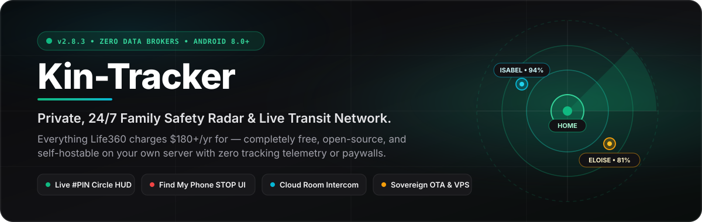
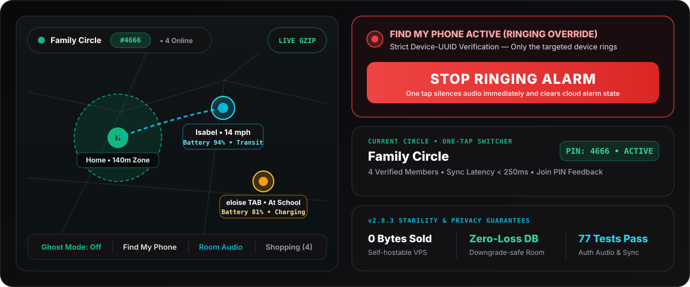
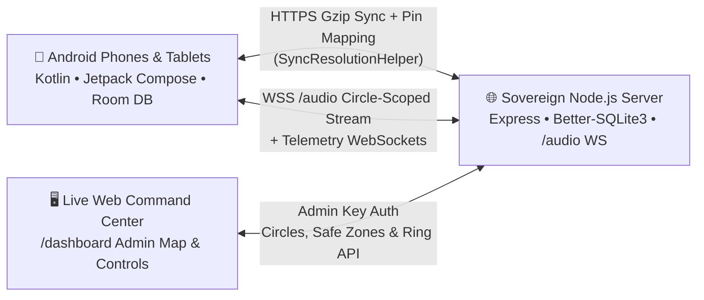

<div align="center">



<br/>

[-10B981?style=for-the-badge&logo=android&logoColor=white)](https://github.com/Viguru24/Kin-Tracker/releases/latest)
[](https://github.com/Viguru24/Kin-Tracker/releases)
[-14B8A6?style=for-the-badge&logo=shield&logoColor=white)](#why-families-switch-from-life360)
[](#architecture--security)
[](LICENSE)

<br/>

<p>
  <a href="#download--30-second-setup"><b>Download &amp; Install</b></a> •
  <a href="#whats-new-in-v283"><b>What's New in v2.8.3</b></a> •
  <a href="#kin-tracker-vs-life360--apple-find-my"><b>Compare</b></a> •
  <a href="#complete-feature-suite"><b>All Features</b></a> •
  <a href="#architecture--security"><b>Architecture</b></a> •
  <a href="#self-host-your-own-sovereign-vps"><b>Self-Host VPS</b></a>
</p>

</div>

---

> **Save $180+/year per family while reclaiming 100% of your location privacy.**  
> **Kin-Tracker** gives your family unlimited geofenced Safe Zones, turn-by-turn transit trails, remote Find My Phone ringing through silent mode, live room audio monitoring, and a synced family grocery list—completely free, ad-free, and hosted on your terms.

<div align="center">



</div>

---

## Why Families Switch From Life360

Commercial tracking apps sell your family's movement history to third-party data brokers while locking basic alerts behind **$14.99+/month** subscriptions. **Kin-Tracker** eliminates the compromise:

1. **Zero Data Brokers & Zero Accounts:** No email sign-ups, no ad SDKs, no location monetization. Create a private family circle and pair devices in 30 seconds with a 4-digit PIN or 6-character invite code.
2. **Engineered Never to Miss an Arrival or Ring:** Built around a hardened Android Foreground Service with per-coroutine hardware `WakeLock` leases, adaptive cellular data compression, and downgrade-safe Room persistence.
3. **Full Self-Hosting Freedom:** Use the default hosted sync relay out of the box, or tap **Server URL** during onboarding or Settings to route 100% of your family's GPS & WebSocket audio traffic to your own private VPS.

---

## Download & 30-Second Setup

<div align="center">

| Ready to install on Android 8.0+? | Step 1 | Step 2 | Step 3 |
| :--- | :--- | :--- | :--- |
| [](https://github.com/Viguru24/Kin-Tracker/releases/latest) | Tap **Download APK** on your Android phone or tablet | Open the `.apk` file and tap **Install** | Pick your name & avatar, then **Create Circle** or enter your family `#PIN` |

</div>

- **Automatic In-App OTA Updates:** Every fresh launch checks your configured server for newer builds so family phones and tablets stay up to date effortlessly.
- **Browse Release History & Checksums:** [github.com/Viguru24/Kin-Tracker/releases](https://github.com/Viguru24/Kin-Tracker/releases)

---

## What's New in v2.8.3

**v2.8.3 (build 48)** builds on the v2.8.2 overhaul with major reliability, safety UI, and synchronization upgrades across Android and the Node.js backend:

- **Full-Screen `STOP` Overlay + Exact Device-UUID Ringing:** Trigger **Find My Phone** from any circle device to ring through silent mode—now backed by strict device-UUID matching (eliminating cross-device false rings on shared family names/tablets) and a large one-tap **STOP** button overlay directly on the ringing phone or tablet.
- **Redesigned Circle Switcher & Live `#PIN` HUD:** See your active circle name and `#PIN` directly inside the top map pill and Current Circle hero card, plus live inline `"Connecting..."` / error feedback when pairing a new device with a PIN.
- **Unified Sync Engine (`SyncResolutionHelper`):** Foreground (`CloudSyncManager`) and background (`BackgroundSyncProcessor`) sync paths now share a single conflict-resolution engine with placeholder token guards (`00000000_`), 30-day shopping-list deletion tombstones, and a 2-minute server-side grace window so newly joined tablets/phones are never overwritten by stale snapshots.
- **Authenticated `/audio` Relay & Resilient WebSockets:** Live room audio WebSocket streams verify circle IDs and member identities before relaying, paired with `45s` ping keepalives and exponential reconnect backoff up to `300s`.
- **Zero-Loss Database Upgrades & Per-Coroutine `WakeLock`s:** Replaced catch-all destructive Room fallback migrations with downgrade-only fallback so saved circles and safe zones survive schema upgrades, isolated location `WakeLock` leases per coroutine, and added a bounded 100-entry diagnostic telemetry buffer in `AppLogger`.
- **Low-Data Gzip Mode:** Strips bulky completed-trip breadcrumb histories from background sync payloads while throttling cellular wakes cleanly (`30s` Wi-Fi / `45s` metered).

---

## Kin-Tracker vs Life360 & Apple Find My

| Capability | Life360 Gold ($14.99+/mo) | Apple Find My | 🛰️ **Kin-Tracker v2.8.3** |
| :--- | :---: | :---: | :---: |
| **Cost Forever** | `$180+/yr` | Free (Apple hardware lock-in) | **$0 Forever (MIT Open Source)** |
| **Location Privacy** | Third-party broker history | Apple Cloud | **Zero Brokers • Self-Hostable VPS** |
| **Unlimited Safe Zones (Geofences)** | ❌ Paywalled (2 free only) | ⚠️ Basic alerts | **✅ Unlimited (Home, School, Work, Custom)** |
| **Find My Phone Through Silent + `STOP` UI** | ⚠️ App-only ping | ✅ iOS only | **✅ High-Priority Alarm + Full-Screen STOP** |
| **Live Room Audio Walkie-Talkie** | ❌ | ❌ | **✅ Authenticated WebSocket Audio** |
| **Railway & Turn-by-Turn Transit Trails** | ❌ Gold/Platinum only | ❌ | **✅ Built-in Breadcrumbs & Train Detection** |
| **Synced Family Shopping & Task List** | ❌ | ❌ | **✅ Real-Time Synced + Tombstone Safe** |
| **One-Tap Ghost Mode Blur** | ⚠️ Bubble tier | ❌ | **✅ 1h / 2h / 8h Instant Blur** |
| **Custom Private Server Support** | ❌ Impossible | ❌ Impossible | **✅ Configurable in Onboarding & Settings** |

---

## Complete Feature Suite

| Feature | How It Works |
| :--- | :--- |
| **🛡️ 24/7 Screen-Off Background Radar** | Foreground location service paired with per-coroutine `WakeLock`s and `AlarmManager` wakeups keeps GPS active through Android Doze without draining your battery. |
| **📍 Smart Safe Zones & Hysteresis** | Customizable Home (`140m`), Work, School, and custom geofences with `60m` exit hysteresis and 3-reading confirmation to filter indoor GPS drift. |
| **🚨 Find My Phone & Emergency SOS** | Remote loud alarm override targeting exact device UUIDs with a giant one-tap **STOP** card, plus instant Emergency SOS distress beacons across your circle. |
| **🎙️ Authenticated Room Audio Intercom** | Tap in to listen to a family member's room monitor stream over circle-scoped `/audio` WebSockets with automatic speaker/IP routing. |
| **🛤️ Transit Mode & Route Playback** | Automatic walking/driving/railway corridor classification (`RailwayTransitDetector`) and interactive breadcrumb trip playback cards. |
| **🗣️ Voice Proximity Announcements** | Optional Text-to-Speech alerts announce safe arrivals, departures, and low-battery warnings (<15%) aloud when hands-free. |
| **👻 Ghost Mode Privacy Pause** | Temporarily pause or blur your live location for preset windows without leaving your family circle. |
| **🛒 Synced Family Shopping List** | Add, check off, and clear shared household groceries in real time across every paired phone and tablet. |
| **🔋 Battery & Charging Telemetry** | Live percentage indicators, charging badges, speed readout, and automatic low-battery notifications on the map. |

---

## Architecture & Security



- **UI & State:** 100% **Kotlin** + **Jetpack Compose** (`Material 3`), reactive **StateFlow** viewmodels, **OSMDroid** offline-capable tiles, and collision-deconflicted family markers.
- **Persistence & Safety:** **Room** SQLite with `MIGRATION_10_11` and downgrade-only destructive fallback, plus an in-memory 100-entry `AppLogger` diagnostic ring buffer.
- **Verified Quality:** Backed by **22 Android unit test suites (77 tests)** via Robolectric/JUnit and end-to-end **Node.js admin & sync server tests**.

---

## Self-Host Your Own Sovereign VPS

Want zero external dependencies? Deploy the included Node.js server (`server/`) on any Linux VPS or Docker host:

```bash
cd server
npm install
cp .env.example .env   # Set PORT and your private ADMIN_KEY
npm start
```

Then open Kin-Tracker on your Android device, tap **Server URL** during setup (or in **Settings → Circle / System**), and enter your VPS HTTPS URL (e.g. `https://tracker.yourdomain.com`). The server also includes an interactive `/dashboard` web map and hosts your own **Over-The-Air (OTA)** update channel (`server/src/routes/updates.js`)—see [OTA_UPDATE_GUIDE.md](OTA_UPDATE_GUIDE.md) for endpoint specs.

---

## Build From Source (Developers)

**Prerequisites:** Android Studio Ladybug+, Android SDK 36, Java JDK 17+, Node.js 20+ (for backend).

```bash
# 1. Clone the repository
git clone https://github.com/Viguru24/Kin-Tracker.git
cd Kin-Tracker

# 2. Run Android & server test suites
./gradlew testDebugUnitTest
npm --prefix server test

# 3. Compile the Android APK
./gradlew assembleDebug
```

Compiled APK outputs are generated under `app/build/outputs/apk/debug/`.

---

## Explore More Sovereign Apps by Viguru24

- 🎬 **[Vixz YouTube Player (Android)](https://github.com/Viguru24/YouTube)** — Ad-free YouTube client with SponsorBlock, AI video summaries, and fluid gestures.
- 🌌 **[Cosmo Symphony (Windows)](https://github.com/Viguru24/Video)** — GPU-accelerated photo & video studio built with Rust & Tauri v2.
- 🎙️ **[CosmoWhisper (Mac & Windows)](https://github.com/Viguru24/CosmoWhisper-Native)** — 100% offline AI voice dictation powered by local Whisper models.

---

<div align="center">
  <sub>Released under the MIT License • Built for family privacy by <a href="https://github.com/Viguru24">Viguru24</a></sub>
</div>
